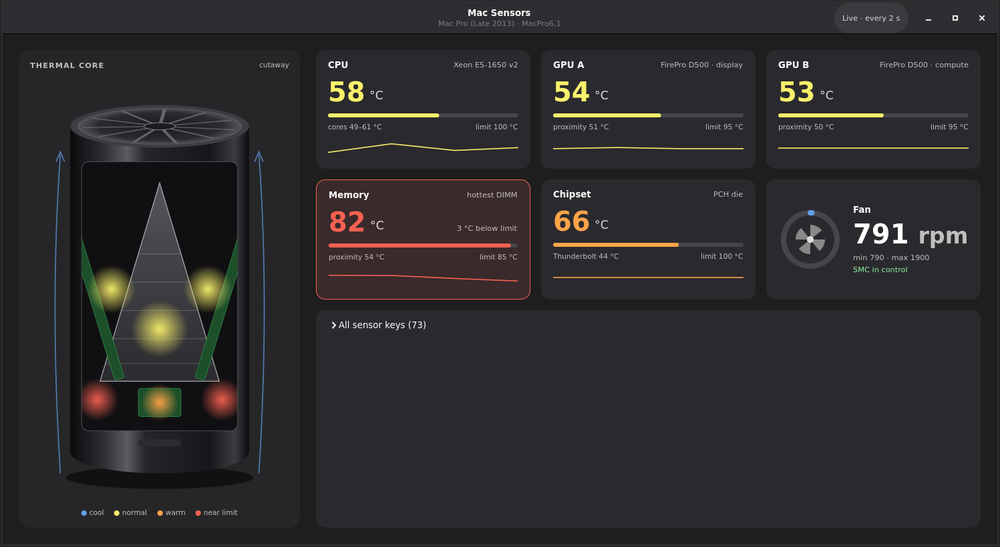
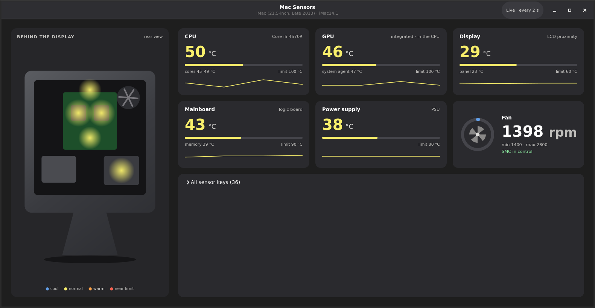

# Mac Sensors

A GTK 4 application that shows the temperatures and fans of an Intel Mac on
a drawing of the machine, for illumos (OpenIndiana).

| Mac Pro (Late 2013) | iMac (21.5-inch, Late 2013) |
|---|---|
|  |  |

## Data sources

- The Apple System Management Controller, through `smcstat -p` of the
  illumos `applesmc` driver (temperatures, fans).
- The kernel sensor framework, `/dev/sensors/temperature/*`
  (`SENSOR_IOCTL_SCALAR`): CPU and chipset temperatures on any machine
  (coretemp, pchtemp, amdnbtemp, ...). The nodes must be readable by the
  user.

The SMC runs the fans on its own; Mac Sensors only reads.

Profiles (by SMBIOS product name): Mac Pro (Late 2013, MacPro6,1) and the
iMacs of 2011 to 2013; the iMac cards are chosen from the keys the SMC
offers. Other machines get the cards without a drawing. All drawings are
the project's own.

## Requirements

Python 3, PyGObject with GTK 4, pycairo.

## Install

    make install DESTDIR=/path/to/proto PREFIX=/usr PYTHON=/usr/bin/python3.9

## Licence

CDDL 1.0, see LICENSE. Copyright 2026 Ignacio Soriano.
